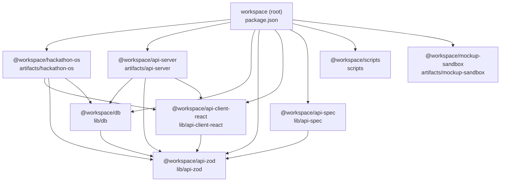
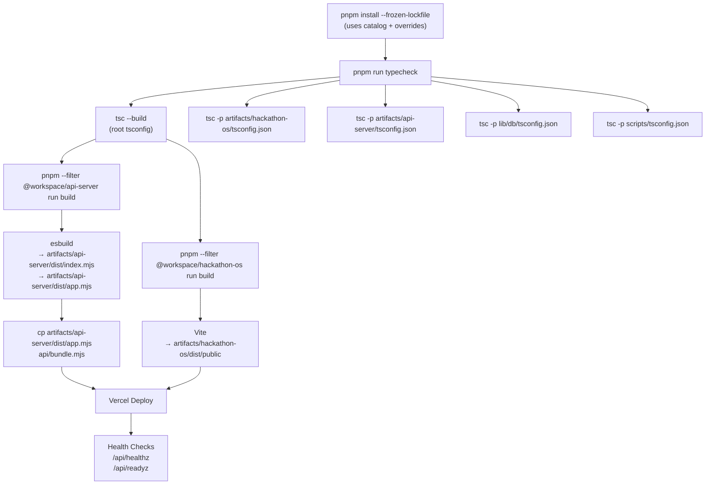
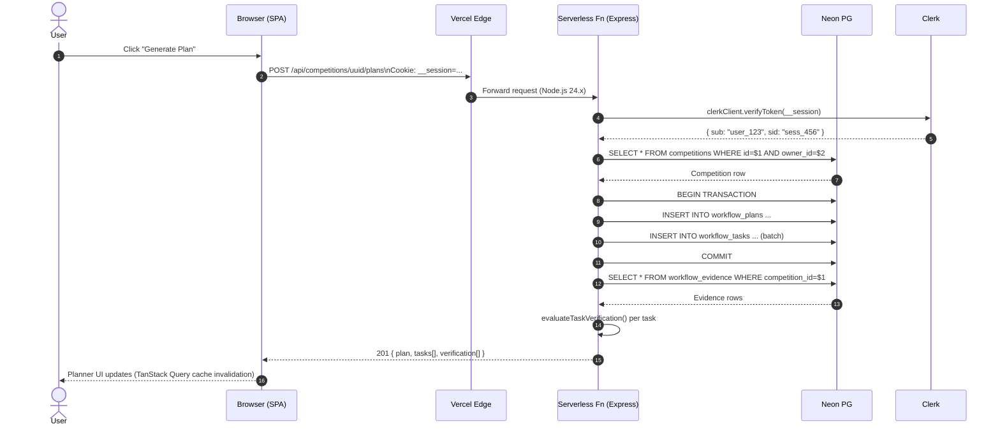
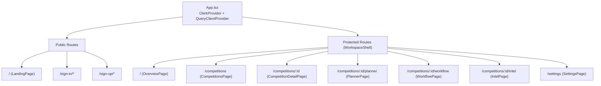

# Architecture Deep Dive

> Detailed architecture documentation for HackathonOS. See [README.md](../README.md#architecture) for the high-level overview.

---

## System Context (Expanded)

```mermaid
graph TD
    subgraph Browser["🌐 Browser (User's Machine)"]
        SPA[React 19 + Vite SPA\n@workspace/hackathon-os]
        SW[Service Worker\n(planned)]
    end

    subgraph Vercel["☁️ Vercel Infrastructure"]
        Static[Static Hosting\nartifacts/hackathon-os/dist/public]
        Edge[Edge Network\nRewrites + Headers]
        Fn[Serverless Function\napi/index.mjs\n@workspace/api-server]
        Cron[Cron Jobs\n(planned: evidence sync)]
    end

    subgraph External["🔗 External Services"]
        PG[(Neon PostgreSQL 16+)]
        Clerk[Clerk Auth\nSessions + Users]
        AI[OpenAI / Compatible\nCompletions API]
        Search[DuckDuckGo / Exa / Brave / Serper\nResearch APIs]
        GH[GitHub\n(planned: webhooks)]
    end

    SPA --> Static
    SPA --> Edge
    Edge --> Fn
    Edge --> Static
    Fn --> PG
    Fn --> Clerk
    Fn --> AI
    Fn --> Search
    SPA --> Clerk
    GH -.-> Fn
    Cron -.-> Fn
```

### Request Flow Details

| Layer | Technology | Responsibility |
|-------|------------|----------------|
| **DNS/CDN** | Vercel Edge | TLS termination, geo-routing, rewrite rules |
| **Static** | Vercel Static | Serves `index.html`, assets (JS/CSS/fonts) with long-term cache |
| **Rewrites** | `vercel.json` | `/api/*` → serverless function; `/*` → `index.html` (SPA fallback) |
| **Function** | Node.js 24.x (Express) | All `/api/*` routes, auth, DB, AI, research |
| **Auth** | Clerk | Session cookie validation, user management |
| **Database** | Neon (PostgreSQL) | Primary persistence, Drizzle ORM |
| **AI** | OpenAI-compatible | Problem analysis, research gaps, ideas, evaluation, briefs |
| **Search** | Multiple providers | Web research with fallback chain |

---

## Monorepo Package Dependency Graph



### Package Responsibilities

| Package | Path | Purpose | Exports |
|---------|------|---------|---------|
| `@workspace/hackathon-os` | `artifacts/hackathon-os` | Frontend SPA | — (Vite build) |
| `@workspace/api-server` | `artifacts/api-server` | Express API server | `./src/index.ts`, `./src/app.ts` |
| `@workspace/db` | `lib/db` | Drizzle schema + migrations | `./src/index.ts`, `./src/schema` |
| `@workspace/api-zod` | `lib/api-zod` | Zod schemas (generated) | `./src/index.ts` |
| `@workspace/api-client-react` | `lib/api-client-react` | TanStack Query hooks (generated) | `./src/index.ts` |
| `@workspace/api-spec` | `lib/api-spec` | OpenAPI + Orval config | — |
| `@workspace/scripts` | `scripts` | Smoke tests, utilities | — |
| `@workspace/mockup-sandbox` | `artifacts/mockup-sandbox` | Design tool (not deployed) | — |

---

## Build & Deploy Pipeline (Detailed)



### Build Commands

```bash
# Root (runs all)
pnpm run build

# Individual packages
cd artifacts/api-server && pnpm run build      # esbuild → dist/
cd artifacts/hackathon-os && pnpm run build    # Vite → dist/public
cd lib/db && pnpm run generate && pnpm run migrate
```

### Vercel Configuration

```json
{
  "installCommand": "pnpm install --frozen-lockfile",
  "buildCommand": "pnpm run build",
  "outputDirectory": "artifacts/hackathon-os/dist/public",
  "functions": {
    "api/index.mjs": { "maxDuration": 30 }
  },
  "rewrites": [
    { "source": "/api/(.*)", "destination": "/api" },
    { "source": "/((?!api/).*)", "destination": "/index.html" }
  ],
  "headers": [ ...CSP + security headers... ]
}
```

---

## Data Flow: Authenticated API Call



### Key Implementation Details

| Step | File | Notes |
|------|------|-------|
| Auth middleware | `artifacts/api-server/src/middlewares/auth.ts` | Uses `@clerk/express` `auth()` |
| Competition ownership | `artifacts/api-server/src/routes/competitions.ts` | `findOwnedCompetition()` joins owner |
| Plan generation | `artifacts/api-server/src/lib/planner.ts` | `createPlanDraft()` deadline-aware |
| Verification | `artifacts/api-server/src/lib/verification.ts` | `evaluateTaskVerification()` recomputed on read |
| Client hooks | `lib/api-client-react/src/generated/api.ts` | Orval-generated TanStack Query hooks |

---

## Frontend Architecture

### Route Structure



### Lazy Loading

```typescript
// App.tsx
const CompetitionsPage = lazy(() => import('@/pages/competitions'));
const CompetitionDetailPage = lazy(() => import('@/pages/competition-detail'));
const IntelPage = lazy(() => import('@/pages/intel'));
const PlannerPage = lazy(() => import('@/pages/planner'));
const WorkflowPage = lazy(() => import('@/pages/workflow'));
const SettingsPage = lazy(() => import('@/pages/settings'));
```

### State Management

| Layer | Tool | Scope |
|-------|------|-------|
| Server state | TanStack Query | All API data (competitions, plans, tasks, evidence, intel) |
| Client state | React `useState` / `useReducer` | UI state (modals, form inputs, sidebar toggle) |
| Auth state | Clerk React hooks | `useUser()`, `useClerk()`, `useAuth()` |
| URL state | Wouter | `useRoute()`, `useLocation()`, `Link` |

### Component Organization

```
artifacts/hackathon-os/src/
├── components/
│   ├── workspace.tsx        # WorkspaceShell, Brand, Sidebar, PageHeading, Button, Panel, etc.
│   ├── ui/                  # Radix-based primitives (Tooltip, Toast, Dialog, etc.)
│   ├── EvidencePanel.tsx    # Evidence display + submission
│   └── CompetitionModal.tsx # Create/edit competition dialog
├── pages/
│   ├── overview.tsx         # Dashboard + next action
│   ├── competitions.tsx     # List + create competition
│   ├── competition-detail.tsx # Competition header + tabs
│   ├── planner.tsx          # Task board with status dropdowns
│   ├── workflow.tsx         # Lifecycle stages with progress
│   ├── intel.tsx            # Analysis, Research, Gaps, Ideas, Briefs tabs
│   └── settings.tsx         # Workspace identity, defaults, tools, danger zone
├── lib/
│   ├── workflow.ts          # Pure lifecycle logic (stages, phases, state derivation)
│   ├── client-env.ts        # VITE_* validation
│   └── *-validation.ts      # Zod schemas for forms
└── test/                    # Vitest + Node tests
```

---

## Intelligence Engine Architecture

```mermaid
graph TD
    subgraph API["Intel API Routes (artifacts/api-server/src/routes/intel.ts)"]
        A1[POST /analysis\n→ Problem Analysis]
        A2[POST /research\n→ Web Search]
        A3[POST /gaps\n→ Gap Analysis]
        A4[POST /ideas\n→ Idea Generation]
        A5[POST /ideas/:id/evaluate\n→ Idea Evaluation]
        A6[POST /ideas/:id/brief\n→ Build Brief]
    end

    subgraph Lib["Intel Libraries (artifacts/api-server/src/lib/intel/)"]
        L1[claims.ts\nClaimKind, Provider normalization]
        L2[problem-analysis.ts\nDeterministic requirements extraction]
        L3[gaps.ts\nDeterministic gap detection]
        L4[ideas.ts\nDimensions, evaluation, comparison]
        L5[research.ts\nMulti-provider search]
        L6[rate-limit.ts\nIn-process window limiters]
        L7[helpers.ts\nCompetition brief, AI provider]
    end

    subgraph AI["AI Providers"]
        P1[OpenAI / Compatible\ncompleteJson()]
    end

    subgraph Search["Search Providers"]
        S1[DuckDuckGo HTML scrape]
        S2[Exa API]
        S3[Brave API]
        S4[Serper API]
    end

    A1 --> L2
    A1 --> P1
    A2 --> L5
    L5 --> S1
    L5 --> S2
    L5 --> S3
    L5 --> S4
    A3 --> L3
    A3 --> P1
    A4 --> L4
    A4 --> P1
    A5 --> L4
    A5 --> P1
    A6 --> L2
    A6 --> L3
    A6 --> L4
    A6 --> P1
```

### Deterministic vs AI-Assisted

| Feature | Deterministic Fallback | AI-Assisted (when provider configured) |
|---------|------------------------|----------------------------------------|
| Problem Analysis | Extract from competition record | Add missing fields, unanswered questions |
| Gap Analysis | Conservative gaps from findings | Additional opportunities |
| Idea Generation | — (requires AI) | Distinct MVP-scoped ideas |
| Idea Evaluation | Manual scores only | Model-proposed scores |
| Build Brief | Structured from idea + requirements | Enhanced sections, missing section detection |

### Rate Limiting

```typescript
// artifacts/api-server/src/lib/intel/rate-limit.ts
const RESEARCH_MAX_PER_MINUTE = 8;
const AI_MAX_PER_MINUTE = 12;

// In-process, per-instance (not distributed)
const researchLimiter = createWindowLimiter(RESEARCH_MAX_PER_MINUTE, 60_000);
const aiLimiter = createWindowLimiter(AI_MAX_PER_MINUTE, 60_000);
```

---

## Security Architecture

### Defense in Depth

```mermaid
graph TD
    subgraph Edge["Vercel Edge"]
        TLS[TLS 1.3]
        HSTS[HSTS Preload]
        Rewrite[Rewrites + Headers]
    end

    subgraph Function["Serverless Function (Express)"]
        Helmet[Helmet Middleware]
        CSP[Content-Security-Policy]
        CORS[CORS: Same-Origin]
        RateLimit[express-rate-limit]
        ClerkAuth[Clerk Session Validation]
        OwnerCheck[Owner Join on Every Query]
        ZodValidate[Zod safeParse]
        DrizzleParam[Drizzle Parameterized Queries]
        SecretScan[Evidence Secret Scanning]
    end

    subgraph Data["Neon PostgreSQL"]
        RLS[Row Level Security (via owner_id joins)]
        SSL[SSL Required]
    end

    TLS --> Helmet
    Helmet --> CSP
    CSP --> CORS
    CORS --> RateLimit
    RateLimit --> ClerkAuth
    ClerkAuth --> OwnerCheck
    OwnerCheck --> ZodValidate
    ZodValidate --> DrizzleParam
    DrizzleParam --> SecretScan
    SecretScan --> RLS
    RLS --> SSL
```

### CSP Policy (from `vercel.json`)

```
default-src 'self';
script-src 'self' https://*.clerk.accounts.dev https://*.clerk.com https://challenges.cloudflare.com;
style-src 'self' 'unsafe-inline' https://fonts.googleapis.com;
font-src 'self' data: https://fonts.gstatic.com;
img-src 'self' data: blob: https://img.clerk.com https://*.clerk.com;
connect-src 'self' https://*.clerk.accounts.dev https://*.clerk.com https://clerk-telemetry.com;
frame-src 'self' https://challenges.cloudflare.com https://*.clerk.accounts.dev;
worker-src 'self' blob:;
object-src 'none';
base-uri 'self';
form-action 'self';
frame-ancestors 'none'
```

### Secret Scanning Patterns

```typescript
// artifacts/api-server/src/routes/evidence.ts
const SECRET_PATTERNS: RegExp[] = [
  /\bsk_(live|test)_[A-Za-z0-9]{10,}/i,      // Stripe secret
  /\bpk_(live|test)_[A-Za-z0-9]{10,}/i,      // Stripe publishable
  /\bAKIA[0-9A-Z]{16}\b/,                     // AWS access key
  /\bgh[pousr]_[A-Za-z0-9]{20,}\b/,           // GitHub tokens
  /\bxox[baprs]-[A-Za-z0-9-]{10,}\b/,         // Slack tokens
  /-----BEGIN [A-Z ]*PRIVATE KEY-----/,       // Private keys
  /eyJ[A-Za-z0-9_-]{10,}\.[A-Za-z0-9_-]{10,}\.[A-Za-z0-9_-]{10,}/, // JWTs
];
```

---

## Observability

### Logging

- **Library**: Pino + Pino-HTTP (structured JSON logs)
- **Levels**: `trace`, `debug`, `info`, `warn`, `error`, `fatal`
- **Configuration**: `LOG_LEVEL` env var (default `info`)
- **Output**: Vercel function logs (stdout)

### Health Endpoints

| Endpoint | Purpose | Auth |
|----------|---------|------|
| `GET /api/healthz` | Liveness (process alive) | ❌ |
| `GET /api/readyz` | Readiness (DB reachable) | ❌ |

### Metrics (Planned)

- [ ] Vercel Analytics (page views, Core Web Vitals)
- [ ] Vercel Speed Insights
- [ ] Custom business metrics (competitions created, plans generated, ideas evaluated)
- [ ] Error tracking (Sentry or similar)

---

## Scaling Considerations

| Component | Current Limit | Scaling Strategy |
|-----------|---------------|------------------|
| Serverless Function | 30s maxDuration, 1024 MB | Optimize cold start; split heavy routes |
| Neon PG | Connection pool (PgBouncer) | Add connection pooler; read replicas |
| Clerk | Managed | N/A |
| AI Provider | Rate limited | Queue + exponential backoff |
| Search Providers | Rate limited | Cache results; fallback chain |
| Frontend | Static assets | CDN caching; code splitting |

---

## Future Architecture Changes

1. **Evidence Collector Service**: Separate worker that runs CI/CD commands and POSTs evidence
2. **WebSocket / Server-Sent Events**: Real-time task updates across tabs
3. **Background Jobs**: Vercel Cron for deadline notifications, stale evidence detection
4. **Multi-region**: Vercel Edge Functions for auth validation closer to user
5. **Event Sourcing**: Audit log for all competition mutations