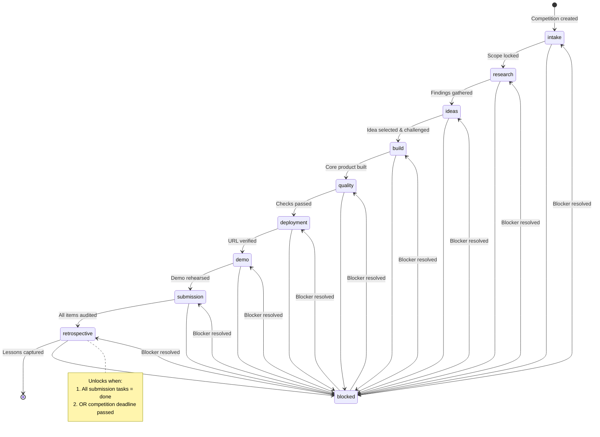
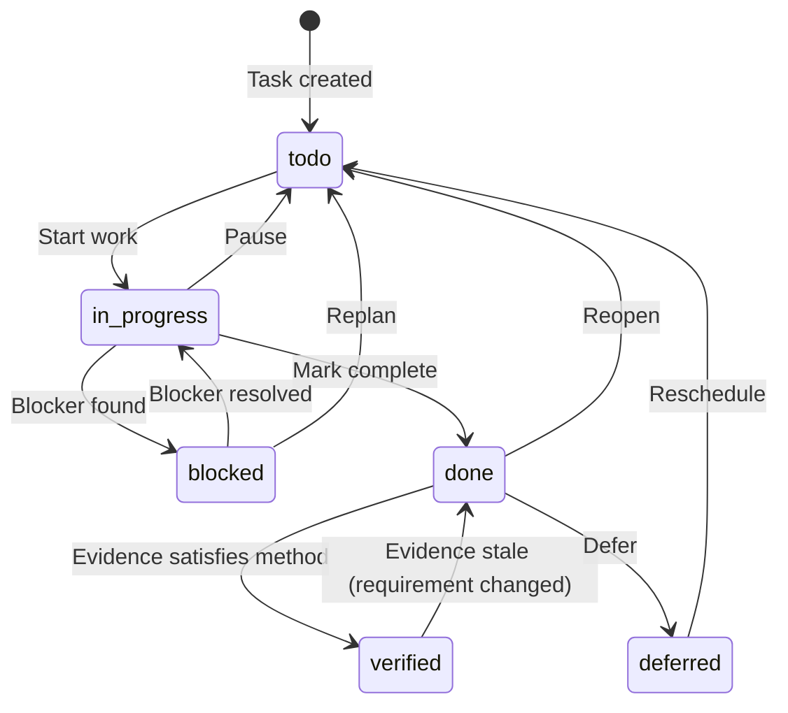

# Workflow & Lifecycle Deep Dive

> Complete reference for the 10 lifecycle stages, task/evidence model, planner behavior, and quality signals.

---

## Lifecycle Stages Overview

HackathonOS models the hackathon as **10 lifecycle stages**. Each stage derives its state from **persisted plan tasks** — there is no manual stage advancement. The UI reflects what the data supports.



---

## Stage Definitions (Source: `artifacts/hackathon-os/src/lib/workflow.ts`)

| Stage ID | Label | Plan Phases | Summary | Unlock Rule |
|----------|-------|-------------|---------|-------------|
| `intake` | Intake & Scope | `intake`, `problem` | Confirm official rules, lock smallest credible scope | Always available |
| `research` | Research | `research` | Gather source-backed findings, separate facts from assumptions | After Intake tasks exist |
| `ideas` | Ideas | `track_selection`, `idea_selection` | Choose track, challenge one idea | After Research tasks exist |
| `build` | Build Workspace | `specification`, `architecture`, `implementation` | Write spec, build smallest complete product | After Ideas tasks exist |
| `quality` | Testing & Security | `testing`, `security` | Run real checks, review private data access | After Build tasks exist |
| `deployment` | Deployment | `deployment` | Publish app, verify production URL | After Quality tasks exist |
| `demo` | Demo & Pitch | `demo`, `pitch` | Rehearse demo, prepare pitch | After Deployment tasks exist |
| `submission` | Submission | `submission` | Audit every required item | After Demo tasks exist |
| `retrospective` | Retrospective | `retrospective_what_worked`, `retrospective_what_failed`, `retrospective_lessons_learned`, `retrospective_next_steps` | Capture lessons; unlocks when Submission complete or deadline passed | **Submission complete** OR **deadline passed** |
| `settings` | Settings & Integrations | — | Workspace name, defaults, tools, danger zone | **Separate page** (`/settings`), always accessible |

### Stage State Derivation (from `deriveStageState`)

```typescript
// Priority order:
1. Any task blocked          → "blocked"
2. All tasks verified        → "verified"
3. All tasks done            → "complete"
4. Any task in_progress      → "active"
5. Tasks exist, none begun   → "scheduled"
6. No tasks                  → "not_started"
```

> A stage with all tasks `done` is `"complete"`. It only becomes `"verified"` when **every task** carries passing evidence.

### Retrospective Unlock Logic (from `buildStageSummaries`)

```typescript
const submissionTasks = tasks.filter(t => t.phase === "submission");
const submissionComplete = submissionTasks.length > 0 &&
  submissionTasks.every(t => t.status === "done");

const isPastDeadline = competitionDeadline ? new Date() > new Date(competitionDeadline) : false;

const retrospectiveUnlocked = submissionComplete || isPastDeadline;

if (!retrospectiveUnlocked) {
  // Shows as "Planned" with tooltip
  return { state: "planned", total: 0, ... };
}
// Otherwise derive from retrospective_* tasks
```

---

## Plan Task Phases (Source: `PlanTaskPhase` in `workflow.ts`)

```typescript
export type PlanTaskPhase =
  | "intake"
  | "problem"
  | "research"
  | "track_selection"
  | "idea_selection"
  | "specification"
  | "architecture"
  | "implementation"
  | "testing"
  | "security"
  | "deployment"
  | "demo"
  | "pitch"
  | "submission"
  | "retrospective_what_worked"
  | "retrospective_what_failed"
  | "retrospective_lessons_learned"
  | "retrospective_next_steps";
```

### Phase → Stage Mapping (from `stageIdForPhase`)

| Phase | Stage |
|-------|-------|
| `intake`, `problem` | `intake` |
| `research` | `research` |
| `track_selection`, `idea_selection` | `ideas` |
| `specification`, `architecture`, `implementation` | `build` |
| `testing`, `security` | `quality` |
| `deployment` | `deployment` |
| `demo`, `pitch` | `demo` |
| `submission` | `submission` |
| `retrospective_*` | `retrospective` |

---

## Task Model

### Task Fields (from `StageTask` / `WorkflowTaskRecord`)

| Field | Type | Description |
|-------|------|-------------|
| `id` | UUID | Primary key |
| `taskKey` | String | Stable identifier (e.g., `"build-product"`) |
| `title` | String | Human-readable title |
| `description` | String | Markdown description |
| `phase` | `PlanTaskPhase` | Which lifecycle phase |
| `priority` | `"critical" \| "high" \| "medium" \| "low"` | Priority |
| `estimatedMinutes` | Integer | Planned effort |
| `plannedStartAt` | Timestamp | Schedule start |
| `plannedEndAt` | Timestamp | Schedule end |
| `dependencies` | String[] | Task keys that must complete first |
| `owner` | String \| null | Assignee (future) |
| `status` | `PlanTaskStatus` | Current state |
| `acceptanceCriteria` | String[] | Checklist for "done" |
| `expectedArtifact` | String \| null | What this produces |
| `verificationMethod` | String | How to verify (e.g., `"Run the app and complete the primary user journey"`) |
| `riskIfSkipped` | String | Why this matters |
| `mandatory` | Boolean | Cannot defer |
| `verified` | Boolean | Evidence satisfies method |

### Task Status Transitions



### Status Values (`PlanTaskStatus`)

| Status | Meaning |
|--------|---------|
| `todo` | Not started, ready to work |
| `in_progress` | Actively being worked on |
| `blocked` | Cannot proceed (dependency, external) |
| `done` | Owner marked complete |
| `deferred` | Intentionally postponed |

---

## Evidence Model

### Evidence Fields (from `WorkflowEvidenceRecord`)

| Field | Type | Description |
|-------|------|-------------|
| `id` | UUID | Primary key |
| `competitionId` | UUID | Parent competition |
| `taskId` | UUID \| null | Task at time of recording (nullable on plan recalc) |
| `taskKey` | String | Stable task identity (survives plan recalc) |
| `type` | `EvidenceType` | Kind of check |
| `summary` | String | What was observed |
| `sourceUrl` | String \| null | Link to artifact (CI log, screenshot) |
| `commandName` | String \| null | CLI command that produced it |
| `result` | `"passed" \| "failed"` | Outcome |
| `observedAt` | Timestamp | When check ran |
| `reviewerNote` | String \| null | Human context |
| `source` | `"manual"` | Always `"manual"` today |
| `phaseSnapshot` | String | Task phase at observation time |
| `verificationMethodSnapshot` | String | Verification method at observation time |

### Evidence Types (`EvidenceType`)

| Type | Use Case |
|------|----------|
| `test_run` | Automated test suite execution |
| `build_output` | Build command success/failure |
| `manual_check` | Human verification (UI, API) |
| `security_review` | Security audit findings |
| `deployment_check` | Deploy command + URL verification |
| `demo_rehearsal` | Demo run from clean state |
| `submission_audit` | Deliverable checklist confirmation |

### Verification Logic (from `evaluateTaskVerification`)

```typescript
// A task is VERIFIED when:
// 1. Task status === "done"
// 2. At least one evidence record exists for its taskKey
// 3. All evidence for that taskKey has result === "passed"
// 4. Evidence.verificationMethodSnapshot === task.verificationMethod
//    (prevents stale evidence after requirement change)
```

> **Key invariant**: Verification is **recomputed on every read**. A status change can never leave a stale `VERIFIED` flag.

---

## Planner Behavior

### Plan Generation (from `createPlanDraft` in `artifacts/api-server/src/lib/planner.ts`)

1. **Calculate available minutes**: `min(deadline - now, requestedHours * 60)`
2. **Select template tier**:
   - `< 3 min` → Deadline-critical single task
   - `≤ 30 min` → Short templates (3 tasks)
   - `≤ 180 min` → Medium templates (6 tasks)
   - `≤ 360 min` → Full templates subset (11 tasks)
   - `> 360 min` → Full templates (14 tasks)
3. **Add submission audit** (always, mandatory)
4. **Adjust for complexity**: `ideaComplexity ≥ 4` adds weight to build/research
5. **Allocate minutes** proportionally by task weight
6. **Schedule sequentially** from `now`
7. **Generate warnings** (no URLs, no deliverables, <2h, high complexity, blocked tasks, team skills missing)
8. **Determine status**: `infeasible` / `at_risk` / `feasible`

### Template Tasks (abridged)

| Task Key | Phase | Priority | Weight | Mandatory |
|----------|-------|----------|--------|-----------|
| `confirm-rules` | `intake` | critical | 6 | No |
| `understand-problem` | `problem` | high | 7 | No |
| `research-solutions` | `research` | high | 10 | No |
| `choose-track` | `track_selection` | high | 5 | No |
| `red-team-idea` | `idea_selection` | high | 8 | No |
| `specify-architecture` | `architecture` | high | 8 | No |
| `build-product` | `implementation` | critical | 30 (+complexity) | No |
| `test-product` | `testing` | critical | 8 | No |
| `review-security` | `security` | high | 5 | No |
| `deploy-product` | `deployment` | high | 5 | No |
| `prepare-demo` | `demo` | high | 5 | No |
| `submission-audit` | `submission` | critical | 5 | **Yes** |

### Versioning

- Each `POST /competitions/:id/plans` increments `version`
- Previous plan tasks preserved (read-only on old versions)
- `previousStatusByKey` carries forward task status across versions

---

## Quality Signals

Returned in `GET /api/overview` (all `"not_run"` until CI integration):

```typescript
quality: {
  applicationBuild: "not_run" | "passed" | "failed",
  automatedTests: "not_run" | "passed" | "failed",
  browserVerification: "not_run" | "passed" | "failed",
  securityReview: "not_run" | "passed" | "failed",
  deployment: "not_run" | "passed" | "failed",
  demoReadiness: "not_run" | "passed" | "failed",
  submissionReadiness: "not_run" | "passed" | "failed",
}
```

### Future CI Integration

```yaml
# .github/workflows/evidence.yml (example)
on:
  workflow_run:
    workflows: ["Build", "Test", "Deploy"]
    types: [completed]

jobs:
  post-evidence:
    runs-on: ubuntu-latest
    steps:
      - uses: actions/checkout@v4
      - name: Post evidence
        run: |
          curl -X POST "$HACKATHONOS_API/competitions/$COMP_ID/tasks/$TASK_ID/evidence" \
            -H "Cookie: __session=$CLERK_SESSION" \
            -d '{"type":"test_run","summary":"${{ github.run_id }}","result":"passed",...}'
```

---

## UI Representation

### Sidebar (from `WorkspaceShell` in `workspace.tsx`)

- Shows all 9 lifecycle stages (Settings removed)
- Each stage: dot + label + lock/IN PLAN chip
- Retrospective lock tooltip: `"Unlocks when Submission is complete or the deadline has passed"`
- Settings link in primary navigation (not lifecycle)

### Workflow Page (from `WorkflowPage` in `workflow.tsx`)

- Sections: Verified → Active/Complete → Blocked → Scheduled → Not Started
- Each stage card: state icon, label, summary, task counts, next task link, blockers
- Retrospective locked: shows lock icon with correct tooltip
- Retrospective unlocked: shows task progress like other stages

### Planner Page (from `PlannerPage` in `planner.tsx`)

- Version selector (dropdown)
- Task board grouped by phase
- Status dropdown per task (`todo` → `in_progress` → `blocked` → `done` → `deferred`)
- Evidence panel inline per task
- Recalculate button (regenerates plan, increments version)

---

## Common Workflows

### Starting a New Competition

1. Sign in → Overview → "Add a competition"
2. Fill name, deadline, optional fields
3. Competition created → redirects to detail
4. Click "Workflow" → see all stages `not_started`
5. Click "Planner" → "Generate plan" → tasks created
6. Work on tasks → status updates flow to Workflow

### Running the Intelligence Engine

1. Open competition → "Intel" tab
2. **Analysis**: Click "Run Analysis" → deterministic + AI requirements
3. **Research**: Enter query → multi-provider search → findings saved
4. **Gaps**: Click "Analyze Gaps" → deterministic + AI opportunities
5. **Ideas**: Click "Generate Ideas" → AI proposes candidates
6. **Evaluate**: Score dimensions (1–5) or "Evaluate with AI"
7. **Decision**: Select one idea → "Selected" status
8. **Brief**: Click "Build Brief" → structured spec from idea + gaps

### Adding Evidence

1. Open Planner → task → Evidence panel
2. Click "Add Evidence"
3. Choose type, write summary, optional URL/command
4. Set result `passed`/`failed`, observed time
5. Submit → task verification recomputed
6. Workflow page updates automatically (TanStack Query invalidation)

---

## Edge Cases & Gotchas

| Scenario | Behavior |
|----------|----------|
| Plan regenerated after tasks marked `done` | `previousStatusByKey` preserves `done` status for matching `taskKey` |
| Evidence submitted for task not in current plan | `taskId` = NULL, `taskKey` preserved; verification works on key |
| Competition deadline passes, no plan | Retrospective unlocks (deadline passed) |
| Submission tasks all `done`, then one reopened | Retrospective locks again (submission no longer complete) |
| Evidence `verificationMethodSnapshot` ≠ current task method | Evidence ignored for verification (stale) |
| Multiple evidence for same task, one `failed` | Task **not** verified (all must pass) |
| Plan `infeasible` status | UI shows warnings; tasks still generated but may exceed deadline |

---

## Extending the Lifecycle

To add a stage (see [CONTRIBUTING.md](../CONTRIBUTING.md#how-to-add-a-lifecycle-stage)):

1. Add phase(s) to `PlanTaskPhase`
2. Add label(s) to `PHASE_LABELS`
3. Add `StageDefinition` to `LIFECYCLE_STAGES`
4. Update `StageId` union
5. Add unlock logic in `buildStageSummaries` if needed
6. Add tests in `test/workflow.test.mjs`
7. Update docs: this file + `README.md` + `docs/architecture.md`

---

## Related Files

| File | Purpose |
|------|---------|
| `artifacts/hackathon-os/src/lib/workflow.ts` | Core lifecycle logic (stages, phases, state derivation) |
| `artifacts/hackathon-os/src/pages/workflow.tsx` | Workflow page UI |
| `artifacts/hackathon-os/src/components/workspace.tsx` | Sidebar lifecycle display |
| `artifacts/api-server/src/lib/planner.ts` | Plan generation from deadline |
| `artifacts/api-server/src/lib/verification.ts` | Evidence evaluation logic |
| `lib/db/src/schema/workflow-plans.ts` | Database schema for plans/tasks |
| `lib/db/src/schema/evidence.ts` | Database schema for evidence |